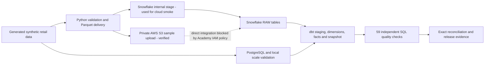

# Data Quality and ETL Validation Framework

An end-to-end data quality engineering portfolio project for a synthetic retail warehouse. It combines Python ingestion and validation, PostgreSQL extraction, Parquet delivery, an AWS S3 sample upload, Snowflake/dbt modeling, independent SQL quality gates, and reproducible defect tests.

**Cloud proof:** a seven-file Parquet sample was uploaded to a private S3 bucket, then loaded into Snowflake through its internal stage. The Academy lab denied the IAM permission required to let Snowflake read directly from S3, so that integration path is documented as blocked rather than presented as completed.

## Results

- **65,434,333 synthetic source records** generated and validated locally; no real customer data.
- **12,101,000 PostgreSQL source rows** extracted and compared exactly across four relational tables.
- **97 Python regression tests**, **59/59 independent SQL quality checks**, and **12/12 deliberate defect types** passed in local validation.
- **65,443-row Snowflake smoke dataset** loaded from seven Parquet files; each raw table matched its expected row count.
- **46/46 Snowflake dbt nodes passed** on the small sample: 10 models, 1 snapshot, 35 data tests.
- **59/59 Snowflake quality checks** and **7/7 exact table reconciliations** passed with zero mismatches.
- The Snowflake X-Small warehouse was suspended after the run.

The large dataset was exercised locally. It was **not** loaded into Snowflake. Local benchmark timings are correctness evidence, not production performance claims. GitHub Actions workflows are included but have not been remotely run.

## AWS and Snowflake: what was actually done

1. Created a private S3 bucket and manually uploaded seven small Parquet files (about 136 KB total) plus a delivery manifest. The upload succeeded with zero failed files.
2. Tried to create the narrow read role needed for a Snowflake S3 storage integration. AWS Academy denied `iam:CreateRole`; the role was not created.
3. Used Snowflake's internal stage for the seven-file sample instead. All seven RAW tables loaded and passed row-count checks.
4. Ran the dbt build, independent cloud checks, and exact seven-table reconciliation against that Snowflake sample.

This demonstrates AWS S3 object delivery and Snowflake warehouse validation. It does **not** claim a completed S3-to-Snowflake storage integration or a full-scale cloud run. The public screenshots are cropped/redacted copies; original screenshots remain private.

## Screenshots

| Evidence | What it shows |
|---|---|
| [AWS S3 sample upload](evidence/screenshots/aws-s3-sample-upload.png) | Seven Parquet files uploaded successfully; private bucket identifier redacted |
| [Snowflake RAW row counts](evidence/screenshots/snowflake-raw-row-counts.png) | All seven sample tables matched expected counts |
| [Snowflake dbt build](evidence/screenshots/snowflake-dbt-build-pass.png) | 46/46 dbt nodes passed on the Snowflake sample |
| [Suspended warehouses](evidence/screenshots/snowflake-warehouses-suspended.png) | Snowflake compute status after validation |

See the [verified execution report](docs/EXECUTION_REPORT.md), [architecture](docs/ARCHITECTURE.md), [test plan](docs/TEST_PLAN.md), [requirements](docs/REQUIREMENTS.md), and [cloud runbook](docs/CLOUD_RUNBOOK.md) for details and limits.

## Quick start

Python 3.11+ is required. A clean checkout starts with the small local fixture:

```bash
python3.11 -m venv .venv
source .venv/bin/activate
python -m pip install -e '.[dev]'
make smoke
make regression
```

The `smoke` target generates a 10,000-order fixture; it is suitable for a basic local check. The 10-million-order benchmark and larger tiers require substantial local disk and memory. They are not needed to inspect the code or reproduce the Snowflake smoke results. Generated datasets, credentials, local databases, and raw screenshots are excluded from Git.

## Architecture



## Repository map

- `src/warehouse_qe/` — deterministic generation, data delivery, profiling, cloud checks and reconciliation.
- `dbt/` — DuckDB and Snowflake profiles, models, snapshot and data tests.
- `config/` — executable SQL quality contracts.
- `tests/` — ingestion, validation, incremental, defect and delivery regression tests.
- `infra/` — database setup and Snowflake SQL scripts.
- `docs/` — architecture, requirements, source-to-target mapping, test cases, runbook and verified results.
- `evidence/` — portable reports and selected redacted screenshots.
- `data/`, `.venv/`, `artifacts/` — local generated state; intentionally not published.
