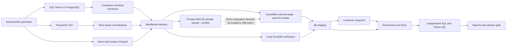

# Architecture and decisions

The same dbt SQL project targets DuckDB and Snowflake. DuckDB executes local logic at scale; it is not a Snowflake emulator. PostgreSQL is an additional source requested by the user; it does not replace the SQL Server skill evidence.

Fact tables: `fct_order_items` at order-line grain, `fct_orders` at order grain, `fct_payments` at order grain after split-payment aggregation. `mart_daily_sales` is at purchase-date grain. Customer keys come from the snapshot version valid at purchase time. Product, seller and date dimensions support the sales mart.

Memory is bounded during generation, extraction and source loading. Large comparisons run inside the database, not in pandas. The exact extraction comparator uses both directions of `EXCEPT ALL`, so duplicate multiplicity and null semantics matter. JSON manifests record content hashes, counts and provenance.

Incremental `fct_orders` uses `delete+insert` with a unique order ID, supported on both adapters. It processes the latest arrival batch inclusively so a replay is deterministic. This requires sequential arrival IDs; history repair/backdated mutation requires explicit replay or full refresh. Order-line facts currently rebuild completely so historical dimension changes and dependent joins are consistently reflected. This is a deliberate correctness-first portfolio choice; a production optimization would selectively rebuild impacted orders.

No external package is necessary for dbt tests. Built-in tests and readable singular SQL make the checks easy to review. Optional tools such as Airflow and Great Expectations are not in the job description and are not needed to prove its requirements.
